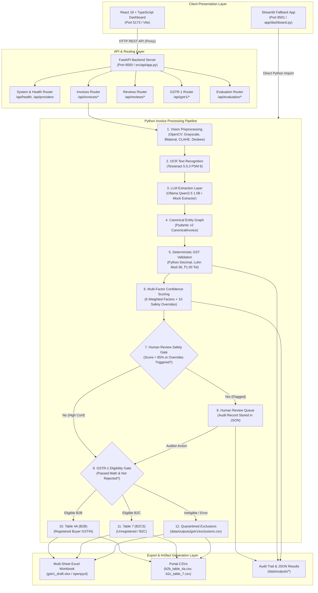
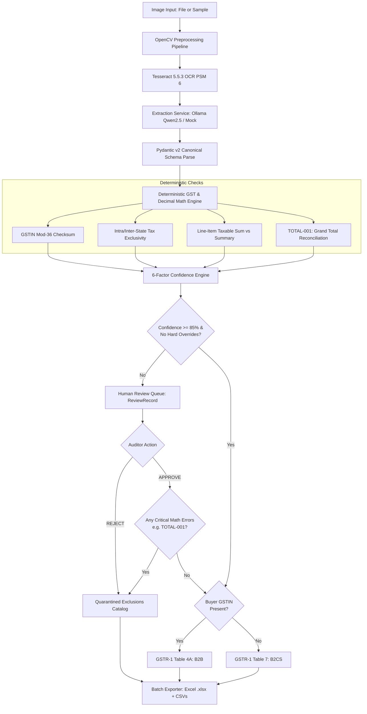

# AI-Powered GST Invoice Processing & GSTR-1 Draft Generation System

[](https://www.python.org/)
[](https://fastapi.tiangolo.com/)
[](https://react.dev/)
[](https://www.typescriptlang.org/)
[](https://vite.dev/)
[](https://tailwindcss.com/)
[](https://github.com/tesseract-ocr/tesseract)
[](https://ollama.com/)
[](#16-contribution-and-license)

> **IMPORTANT STATUTORY NOTICE:**  
> This software is an **academic prototype and automated draft preparation assistant**. It **does not file returns autonomously with the Goods and Services Tax Network (GSTN)**, does not connect to live government tax filing APIs, and does not provide legal or financial tax advisory. All generated GSTR-1 drafts, CSVs, and Excel files must undergo mandatory review and verification by an authorized signatory before submission on the GST portal.

---

## Table of Contents

1. [Project Introduction](#1-project-introduction)
   - [Project Overview](#project-overview)
   - [Problem Statement](#problem-statement)
   - [Proposed Solution](#proposed-solution)
   - [Key Objectives](#key-objectives)
   - [Key Features](#key-features)
   - [Intended Users](#intended-users)
   - [Scope and Limitations](#scope-and-limitations)
2. [Technology Stack](#2-technology-stack)
3. [System Architecture](#3-system-architecture)
   - [Architecture Diagram](#architecture-diagram)
   - [Architectural Principles & Separation of Concerns](#architectural-principles--separation-of-concerns)
   - [Data Flow to CSV and Excel Exports](#data-flow-to-csv-and-excel-exports)
4. [Frontend Workflow](#4-frontend-workflow)
   - [User Journey Diagram](#user-journey-diagram)
   - [Application Routes & Views](#application-routes--views)
5. [Backend Workflow](#5-backend-workflow)
   - [Pipeline Processing Sequence](#pipeline-processing-sequence)
   - [Backend Execution Flowchart](#backend-execution-flowchart)
6. [GSTR-1 Draft Safety & Validation Design](#6-gstr-1-draft-safety--validation-design)
   - [Deterministic Decimal Calculations](#deterministic-decimal-calculations)
   - [Mandatory Grand-Total Reconciliation (`TOTAL-001`)](#mandatory-grand-total-reconciliation-total-001)
   - [Human Review Safety Invariant](#human-review-safety-invariant)
   - [Synthetic Invalid Invoice Case Study (`INV_INV_001`)](#synthetic-invalid-invoice-case-study-inv_inv_001)
7. [Repository Structure](#7-repository-structure)
8. [Prerequisites](#8-prerequisites)
9. [Installation and Setup](#9-installation-and-setup)
10. [How to Run the Application](#10-how-to-run-the-application)
    - [Terminal 1: FastAPI Backend](#terminal-1-fastapi-backend)
    - [Terminal 2: React Frontend](#terminal-2-react-frontend)
    - [Streamlit Fallback Application](#streamlit-fallback-application)
11. [First-Time User Guide](#11-first-time-user-guide)
12. [API Documentation](#12-api-documentation)
13. [Testing](#13-testing)
    - [Running Automated Tests](#running-automated-tests)
    - [Audited Benchmark & Regression Results](#audited-benchmark--regression-results)
14. [Troubleshooting](#14-troubleshooting)
15. [Security, Privacy, and Limitations](#15-security-privacy-and-limitations)
16. [Contribution and License](#16-contribution-and-license)
17. [Documentation Index](#17-documentation-index)

---

## 1. Project Introduction

### Project Overview
The **AI-Powered GST Invoice Processing and GSTR-1 Draft Generation System** is an end-to-end intelligent document processing (IDP) and compliance preparation application. It automates the digitization of Indian GST tax invoices (PDF and raster images), extracts structured transaction entities, applies deterministic financial and statutory validation rules, computes multi-factor confidence scores with safety overrides, provides human-in-the-loop review queues, and classifies eligible transactions into audit-ready GSTR-1 draft tables (Table 4A B2B and Table 7 B2CS) exported to Excel and CSV formats.

### Problem Statement
Small and medium enterprises (SMEs), accounting firms, and tax consultants in India process hundreds of vendor invoices monthly. Manual invoice data entry is slow, error-prone, and labor-intensive. Pure optical character recognition (OCR) systems frequently misread noisy, skewed, or low-resolution scans. Conversely, purely generative AI (LLM) extractors introduce numeric hallucinations, floating-point rounding drifts, and non-deterministic tax calculations that violate statutory compliance.

### Proposed Solution
This system introduces a **hybrid deterministic-generative architecture**:
1. **Vision Preprocessing:** OpenCV filters reduce character error rates before OCR.
2. **Text Recognition:** Tesseract OCR extracts raw text tokens and character bounding confidence.
3. **Structured Entity Extraction:** A local Ollama LLM (`Qwen2.5 1.5B`) or deterministic mock extractor structures the unstructured text into a canonical Pydantic v2 schema (`CanonicalInvoice`).
4. **Deterministic GST & Financial Validation Engine:** Pure Python `decimal.Decimal` logic enforces exact arithmetic, GSTIN Luhn Modulo-36 checksums, and tax type consistency.
5. **Multi-Factor Confidence Scoring:** A 6-factor weighted engine scores extraction reliability and triggers 10 safety overrides for human review.
6. **GSTR-1 Draft Preparation:** An eligibility gate quarantines invalid invoices and routes compliant records into official GSTR-1 tables.

### Key Objectives
- Achieve high-fidelity field extraction on scanned and camera-captured invoices without transmitting sensitive data to third-party cloud APIs.
- Guarantee bit-exact financial accuracy where Python arithmetic is authoritative over LLM output.
- Prevent non-compliant or mathematically flawed invoices from leaking into statutory tax return drafts.
- Provide full provenance, audit logging, and human reviewer intervention workflows.

### Key Features
- **Zero Data Leakage:** Fully local document processing using on-device Tesseract OCR and local Ollama inference (`qwen2.5:1.5b`).
- **OpenCV Vision Enhancements:** Grayscale conversion, Bilateral Denoising, Contrast Limited Adaptive Histogram Equalization (CLAHE), Hough Transform deskewing ($\pm 45^\circ$), and adaptive thresholding.
- **Strict Pydantic v2 Schema:** Normalized canonical model representing invoice metadata, seller/buyer entities, line items, and tax summaries.
- **Statutory GST Validation:** 15-character GSTIN regex validation, state code extraction, Luhn Mod-36 checksum verification, intra-state (CGST+SGST) vs. inter-state (IGST) consistency, and grand total reconciliation.
- **Human-in-the-Loop (HITL) Queue:** Visual inspection interface with explicit `APPROVE`, `REJECT`, and `REQUEST_REPROCESSING` actions backed by persistent JSON audit trails.
- **Statutory GSTR-1 Routing:** Automatic classification into **Table 4A (B2B)** for registered recipients and **Table 7 (B2CS)** for unregistered consumer sales.
- **Multi-Format Draft Exports:** Downloadable multi-sheet Excel workbook (`gstr1_draft.xlsx`) and portal-compatible CSV files (`b2b_table_4a.csv`, `b2c_table_7.csv`, `exclusions.csv`, and combined `gstr1_draft.csv`).
- **Dual User Interfaces:** Modern React 18 + TypeScript + Vite + Tailwind CSS dashboard alongside a Streamlit fallback application.

### Intended Users
- **Accountants & Tax Practitioners:** Automate initial invoice transcription, reconciliation, and GSTR-1 draft compilation.
- **SME Business Owners:** Digitize billing workflows and detect supplier billing errors.
- **Software Engineers & Researchers:** Study hybrid LLM + deterministic validation architectures and reproducible document intelligence pipelines.
- **Academic Evaluators:** Benchmark OCR, information extraction, and rule engines on standardized datasets.

### Scope and Limitations
- **Draft Preparation Only:** The software compiles offline drafts; it does **not** authenticate against the government GSTN portal or transmit returns.
- **Document Orientation:** Extremely degraded scans or documents rotated beyond $\pm 45^\circ$ require manual auditor review.
- **Hardware Latency:** Local LLM inference on CPU hardware requires ~7–10 seconds per invoice; GPU acceleration or deterministic mock extractors are available for instant throughput.

---

## 2. Technology Stack

Every component documented below is actively present in the repository codebase.

```
├── Frontend: React 18.3 + TypeScript 5.6 + Vite 6.0 + Tailwind CSS 3.4
├── Backend: Python 3.12 + FastAPI 0.110 + Uvicorn 0.28 + Pydantic 2.6
├── Document Processing: OpenCV 4.8 (Headless) + Tesseract OCR 5.5 + pytesseract 0.3.10
├── AI & Extraction: Ollama (Qwen2.5 1.5B) + Deterministic Mock Extractor + Optional Cloud SDKs
├── Financial Engine: Python decimal.Decimal + Luhn Modulo-36 Checksum Engine
└── Data & Exports: pandas 2.2 + openpyxl 3.1 (Excel) + Built-in CSV Engine
```

### Frontend (`frontend/package.json`)
- **Core Library:** [React 18.3.1](https://react.dev/)
- **Language:** [TypeScript ~5.6.2](https://www.typescriptlang.org/)
- **Build Tool & Dev Server:** [Vite ^6.0.1](https://vite.dev/) with `@vitejs/plugin-react ^4.3.4`
- **Styling:** [Tailwind CSS ^3.4.16](https://tailwindcss.com/) with [PostCSS ^8.4.49](https://postcss.org/) and [Autoprefixer ^10.4.20](https://github.com/postcss/autoprefixer)
- **Routing:** [React Router DOM ^6.28.0](https://reactrouter.com/)
- **Icons:** [Lucide React ^0.475.0](https://lucide.dev/)
- **Data Visualization:** [Recharts ^2.15.0](https://recharts.org/)
- **Style Utilities:** `clsx ^2.1.1` and `tailwind-merge ^2.6.0`
- **State Management:** React Component State & Hooks (`useState`, `useEffect`) consuming the typed REST client in [frontend/src/lib/api.ts](frontend/src/lib/api.ts).

### Backend (`requirements.txt`)
- **Runtime:** Python 3.12+
- **API Framework:** [FastAPI >=0.110.0](https://fastapi.tiangolo.com/)
- **ASGI Server:** [Uvicorn >=0.28.0](https://www.uvicorn.org/)
- **Data Modeling:** [Pydantic >=2.6.0](https://docs.pydantic.dev/) (Pydantic v2 models with strict field validation)
- **Multipart Form Uploads:** `python-multipart >=0.0.9`
- **Environment Management:** `python-dotenv ==1.0.1`

### Document & Vision Processing (`requirements.txt`)
- **Computer Vision:** `opencv-python-headless >=4.8.0` & `numpy >=1.26.0` (CLAHE, Bilateral Filter, Hough Deskew, Resize)
- **OCR Engine:** Tesseract OCR 5.x CLI binary via `pytesseract ==0.3.10`
- **Text Metrics:** `Levenshtein ==0.25.0` (for Character Error Rate and Word Error Rate calculation)

### Artificial Intelligence & Extraction Providers (`src/extraction/`)
- **Primary Local LLM:** [Ollama](https://ollama.com/) hosting `qwen2.5:1.5b` with strict JSON mode output (`src/extraction/llm_client.py:OllamaClient`)
- **Deterministic Mock Provider:** Zero-cost offline regex & pattern-matching fallback parser (`src/extraction/llm_client.py:MockLLMClient`)
- **Optional Cloud Providers:** `google-genai >=2.0.0` (Gemini Client) and OpenAI Chat Completions JSON API (OpenAI Client) via environment configuration

### Deterministic Financial Engine (`src/validation/` & `src/confidence/`)
- **Exact Numeric Arithmetic:** Python standard library `decimal.Decimal` with statutory `ROUND_HALF_UP` precision
- **Tax Validation:** Statutory Luhn Mod-36 checksum calculation, State Code verification, and `TOTAL-001` reconciliation
- **Confidence Scoring:** 6-factor weighted mathematical scoring engine + 10 safety override rules
- **Human Review Safety:** Invariant enforcement in `src/gst/gstr1_mapper.py`

### Data Storage & Exports (`src/export/` & `app/`)
- **Spreadsheet Generation:** `openpyxl >=3.1.2` (Multi-sheet styled `.xlsx` workbook)
- **Tabular Data & CSV:** `pandas ==2.2.1` & standard library `csv` module
- **Filesystem Persistence:** Partitioned output directories under `data/outputs/`
- **Fallback UI:** `streamlit ==1.32.2` ([app/dashboard.py](app/dashboard.py))

---

## 3. System Architecture

The architecture enforces a strict **separation of concerns**: the LLM functions strictly as an unstructured-to-canonical text interpreter, while the Python deterministic validation engine acts as the sole authoritative judge of financial calculations and statutory eligibility.

### Architecture Diagram



### Architectural Principles & Separation of Concerns

1. **Physical Decoupling of AI and Financial Math:**  
   Large language models are inherently probabilistic and vulnerable to arithmetic errors. In this system, the LLM is given no authority over tax calculations. The LLM extracts declared text; Python's `Decimal` engine recomputes all line items, tax brackets, and grand totals from scratch.
2. **Immutable Source Governance:**  
   Raw OCR tokens and initial canonical extraction payloads remain immutable. Auditor actions are saved as distinct, timestamped `ReviewRecord` structures layered over the source data.
3. **Hard Regulatory Invariants:**  
   If an invoice fails mathematical reconciliation (`TOTAL-001`), no human reviewer can force it into the GSTR-1 draft tables. The eligibility gate unconditionally blocks it.

### Data Flow to CSV and Excel Exports
Eligible and excluded records are synthesized by `src/gst/gstr1_generator.py`:
- **Table 4A (B2B):** Written to `b2b_table_4a.csv` with recipient GSTIN, invoice date, taxable value, and tax breakdown.
- **Table 7 (B2CS):** Written to `b2c_table_7.csv` aggregating consumer supplies by Place of Supply and tax rate.
- **Exclusions Catalog:** Written to `exclusions.csv` recording the source invoice ID, validation errors, confidence scores, and exclusion justification.
- **Combined Excel Workbook:** [src/export/gstr1_excel.py](src/export/gstr1_excel.py) uses `openpyxl` to build `gstr1_draft.xlsx` featuring five styled worksheets: `Summary`, `B2B_Table_4A`, `B2C_Table_7`, `Exclusions`, and `Validation_Report`.

---

## 4. Frontend Workflow

The React frontend operates as an independent Single Page Application (SPA) communicating with the FastAPI backend through a Vite reverse proxy.

### User Journey Diagram

```mermaid
flowchart LR
    Start([User Opens Dashboard]) --> SelectInvoice[Navigate to /studio<br/>Select or Upload Invoice]
    SelectInvoice --> RunPipeline[Select Provider &<br/>Click Process Invoice]
    RunPipeline --> InspectExtraction[Navigate to /extraction<br/>Compare OCR vs Structured JSON]
    InspectExtraction --> InspectValidation[Navigate to /validation<br/>Inspect Declared vs Calculated Math]
    InspectValidation --> ReviewDecision{Requires<br/>Review?}
    ReviewDecision -->|Yes| AuditView[Navigate to /review<br/>Approve / Reject with Notes]
    ReviewDecision -->|No| DraftView[Navigate to /gstr1<br/>View Admitted Tables]
    AuditView --> DraftView
    DraftView --> Download[Download Excel Workbook<br/>& Portal-Ready CSVs]
```



### Application Routes & Views

All routes are defined in [frontend/src/app/App.tsx](frontend/src/app/App.tsx):

| Route | View Component | What the User Sees | User Actions | Backend APIs Called |
| :--- | :--- | :--- | :--- | :--- |
| `/` | `ExecutiveOverview` | KPI stat cards, system readiness indicators, pipeline principles, and statutory notice. | View system health, navigate to studio. | `GET /api/health` |
| `/studio` | `InvoiceStudio` | Dual-pane workspace: invoice image canvas on left; sample picker, upload dropzone, provider selector on right. | Select sample (Clean, Multi, Noisy, Invalid), drag-and-drop custom invoice, select LLM provider, trigger pipeline. | `GET /api/invoices/samples`<br/>`POST /api/invoices/upload`<br/>`POST /api/invoices/process` |
| `/extraction` | `ExtractionInspector` | Side-by-side comparison of raw Tesseract OCR text tokens versus the Pydantic canonical entity tree. | Toggle JSON tree, copy field values, view extraction confidence. | Uses active pipeline result |
| `/validation` | `GSTValidationView` | Traffic-light status banner (PASS / FAIL), Declared vs Calculated financial breakdown cards, rule checklist. | Inspect line item arithmetic discrepancies (`TOTAL-001`, `MATH-001`), verify GSTIN validity. | Uses active pipeline result |
| `/review` | `ConfidenceReviewView` | 6-factor confidence weight breakdown, triggered risk rules, and audit action panel. | Submit `APPROVE`, `REJECT`, or `REQUEST_REPROCESSING` with mandatory auditor notes. | `GET /api/reviews/{id}`<br/>`POST /api/reviews/{id}/action` |
| `/gstr1` | `GSTR1DraftView` | Tabbed draft tables: Table 4A (B2B), Table 7 (B2CS), Quarantined Exclusions catalog, Lineage trace. | Inspect admitted records, view exclusion reasons, trigger batch run, download exports. | `GET /api/gstr1/draft`<br/>`POST /api/gstr1/batch/run`<br/>`GET /api/gstr1/exports/{type}` |
| `/evaluation` | `TestingEvaluationView` | Test summary cards, OCR CER/WER delta tables, confusion matrices, and category breakdowns. | View scientific evaluation benchmarks from canonical dataset. | `GET /api/evaluation/metrics` |
| `/performance`| `PerformanceProfilingView`| Stage latency charts, throughput KPIs, memory RSS/heap meters, Recharts visualizations. | Inspect sub-system bottlenecks and processing times. | `GET /api/evaluation/performance` |
| `/architecture`| `ArchitectureView` | High-level system architecture blueprint, physical layer matrix, and Viva examination Q&A. | Read architectural rationale, expand viva question cards. | `GET /api/architecture/summary` |

---

## 5. Backend Workflow

The backend pipeline processes an invoice image across eleven discrete stages implemented across dedicated service classes in `src/`.

### Pipeline Processing Sequence

1. **Ingestion (`src/api/routers/invoices.py`):** An invoice is uploaded via `POST /api/invoices/upload` or picked from canonical samples via `GET /api/invoices/samples`.
2. **Vision Preprocessing (`src/preprocessing/pipeline.py`):** OpenCV loads the image, converts to grayscale, applies bilateral filtering, enhances text contrast via CLAHE, resizes by 2x, and corrects skew using Hough Transform angles.
3. **Text Recognition (`src/ocr/service.py`):** Tesseract OCR 5.x runs under Page Segmentation Mode (PSM) 6, returning raw UTF-8 text tokens and average word-level confidence.
4. **Structured Extraction (`src/extraction/service.py`):** Prompt templates ([src/extraction/prompts.py](src/extraction/prompts.py)) pass OCR tokens to the configured LLM client (`OllamaClient` or `MockLLMClient`) demanding a structured JSON payload.
5. **Schema Validation (`src/extraction/parser.py`):** The raw JSON is validated against the Pydantic v2 `CanonicalInvoice` schema, populating defaults for missing optional fields without crashing.
6. **Deterministic GST Validation (`src/validation/service.py`):** Pure Python `Decimal` algorithms evaluate GSTIN syntax and Modulo 36 checksums, State Code vs. Place of Supply consistency, line-item tax sums, tax rate verification, and Grand Total reconciliation.
7. **Confidence Scoring (`src/confidence/service.py`):** The 6-factor engine computes a weighted score (0–100%) and tests against 10 hard safety rules. Invoices scoring below 85% or triggering safety rules are flagged for review.
8. **Human Review Handling (`src/confidence/service.py`):** The invoice is assigned a `ReviewRecord`. If flagged, auditor approval or rejection is recorded with a mandatory note.
9. **GSTR-1 Eligibility Evaluation (`src/gst/gstr1_mapper.py`):** The eligibility gate checks if the invoice is free of fatal errors (`TOTAL-001`, `MATH-001`, missing mandatory fields) and has either Auto-Accept status or explicit human approval.
10. **Draft Table Mapping (`src/gst/gstr1_mapper.py`):** Eligible invoices with a buyer GSTIN map to Table 4A (B2B); eligible invoices without a buyer GSTIN map to Table 7 (B2CS). Ineligible invoices produce a `GSTR1ExclusionRecord`.
11. **Export Generation (`src/export/`):** Batch routines write CSV tables and build the multi-sheet styled `gstr1_draft.xlsx` workbook.

### Backend Execution Flowchart



---

## 6. GSTR-1 Draft Safety & Validation Design

### Deterministic Decimal Calculations
Standard IEEE 754 floating-point types (`float`) cannot represent decimal fractions precisely (e.g., `0.1 + 0.2 = 0.30000000000000004`). In financial tax compliance, rounding errors compound across line items. All calculations in [src/validation/arithmetic.py](src/validation/arithmetic.py) utilize Python's `decimal.Decimal` with statutory rounding tolerances:
$$\text{Taxable Value} = \sum \text{Line Item Taxable Values}$$
$$\text{Expected Tax} = \text{round}\left(\text{Taxable Value} \times \frac{\text{Rate}}{100}, 2\right)$$
$$\text{Reconciled Grand Total} = \text{Taxable Value} + \text{CGST} + \text{SGST} + \text{IGST}$$

### Mandatory Grand-Total Reconciliation (`TOTAL-001`)
The engine enforces rule `TOTAL-001`: if the absolute difference between the declared grand total and the recomputed sum exceeds the configured tolerance ($\pm ₹1.00$), an `ERROR` issue is raised:
```python
if abs(calculated_grand_total - extracted_grand_total) > amount_tolerance:
    # Trigger Rule TOTAL-001 (Fatal Validation Error)
```

### Human Review Safety Invariant
In `src/gst/gstr1_mapper.py` (`check_invoice_eligibility`), validation errors take unconditional priority over reviewer approvals:
```python
# Even if review_record.review_status == "APPROVED":
if validation_result and any(i.severity == "ERROR" for i in validation_result.issues):
    return False, exclusion_record # BLOCKED FROM GSTR-1
```
**An auditor cannot bypass a mathematical discrepancy.** This invariant ensures that human error cannot compromise statutory draft integrity.

### Synthetic Invalid Invoice Case Study (`INV_INV_001`)
The repository contains canonical synthetic test fixture `INV_INV_001.png` designed specifically to test this safety mechanism:
- **Declared Line Item:** Product 1, Taxable Value ₹1,000.00, CGST ₹90.00, SGST ₹90.00
- **Declared Grand Total on Invoice:** **₹1,500.00** (an intentional ₹320.00 arithmetic defect)
- **Calculated Grand Total:** ₹1,000.00 + ₹90.00 + ₹90.00 = **₹1,180.00**
- **Validation Engine Response:** Triggers rule `TOTAL-001`, marks validation status `FAIL`.
- **Review Simulation:** An auditor marks `INV_INV_001` as `APPROVED` with notes in `/review`.
- **Eligibility Gate Verdict:** The eligibility gate intercepts the approval, flags the critical `TOTAL-001` failure, and excludes the record to `data/outputs/gstr1/exclusions.csv`. Table 4A remains uncorrupted.

---

## 7. Repository Structure

```
.
├── .env.example                     # Environment configuration template
├── .gitignore                        # Git exclusion rules (ignores .env, .venv, node_modules)
├── README.md                         # Comprehensive project documentation
├── requirements.txt                  # Python dependencies
├── app/
│   ├── __init__.py
│   └── dashboard.py                  # Streamlit fallback application (9 workspaces)
├── data/
│   ├── raw/
│   │   ├── invoices/                 # 25 canonical benchmark invoices (PNG)
│   │   └── metadata/                 # Invoice ground truth metadata
│   ├── processed/
│   │   ├── temp/                     # Preprocessed images and uploads
│   │   └── final/                    # Processed invoice images
│   ├── outputs/
│   │   ├── confidence/               # Confidence evaluations and reviewer JSON records
│   │   ├── evaluation/               # Phase 10 benchmark CSVs and confusion matrices
│   │   ├── extraction/               # Raw OCR and structured canonical JSON files
│   │   ├── gstr1/                    # GSTR-1 drafts: Excel (.xlsx) and portal CSVs
│   │   ├── ocr/                      # Raw OCR extraction outputs
│   │   ├── performance/              # Phase 11 latency and throughput metrics
│   │   ├── self_test/                # Full-system self-test reports
│   │   └── validation/               # Validation result JSON files
│   └── samples/                      # Categorized test sample fixtures
├── docs/                             # Comprehensive project documentation (13 reports)
│   ├── CROSS_PHASE_SYSTEM_AUDIT.md
│   ├── DATASET_DOCUMENTATION.md
│   ├── DEVELOPER_GUIDE.md
│   ├── END_TO_END_TEST_REPORT.md
│   ├── EVALUATION_SUMMARY.md
│   ├── FINAL_PROJECT_REPORT.md
│   ├── FINAL_SYSTEM_ARCHITECTURE.md
│   ├── USER_GUIDE.md
│   └── ...
├── frontend/                         # Modern React 18 + TypeScript + Vite SPA
│   ├── index.html                    # Single-page application entrypoint
│   ├── package.json                  # Frontend dependencies and npm scripts
│   ├── postcss.config.js             # PostCSS Tailwind plugins
│   ├── tailwind.config.js            # Tailwind typography, colors, and layout tokens
│   ├── tsconfig.json                 # TypeScript compiler options
│   ├── vite.config.ts                # Vite dev server configuration and /api proxy
│   └── src/
│       ├── main.tsx                  # React DOM root mounting
│       ├── app/                      # App root and React Router definitions
│       ├── components/               # Common UI widgets (Card, Button, Modal, StatCard)
│       ├── features/                 # Modular feature views (studio, gstr1, review, etc.)
│       ├── lib/                      # REST API client (api.ts) and helper utilities
│       ├── styles/                   # Global CSS and Tailwind directives
│       └── types/                    # TypeScript interfaces for API models
├── src/                              # Core Python invoice processing backend
│   ├── __init__.py
│   ├── api/                          # FastAPI REST endpoints and Pydantic request models
│   │   ├── app.py                    # FastAPI application instance and CORS configuration
│   │   ├── models.py                 # API request/response models
│   │   └── routers/                  # Router modules (system, invoices, reviews, gstr1, eval)
│   ├── preprocessing/                # OpenCV image enhancement pipeline
│   ├── ocr/                          # Tesseract OCR engine wrapper and models
│   ├── extraction/                   # Structured entity extraction and LLM providers
│   ├── validation/                   # Deterministic GST, Luhn Mod-36, and Decimal math engine
│   ├── confidence/                   # 6-Factor confidence scoring engine and review service
│   ├── gst/                          # GSTR-1 mapper, models, and eligibility gate
│   ├── export/                       # Portal CSV and 5-sheet Excel export builders
│   └── utils/                        # Batch processors, evaluation scripts, and loggers
└── tests/                            # Automated test suite (Pytest)
    ├── test_api.py                   # FastAPI endpoint tests
    ├── test_app_integration.py       # Integration tests
    ├── test_confidence.py            # Multi-factor confidence scoring tests
    ├── test_dataset_integrity.py     # Dataset format and metadata integrity tests
    ├── test_e2e_comprehensive.py     # 6-phase live system integration tests
    ├── test_evaluation_phase10.py    # Phase 10 evaluation artifact tests
    ├── test_extraction.py            # Pydantic schema and LLM provider tests
    ├── test_gstr1.py                 # Table 4A/7 classification and export tests
    ├── test_ocr.py                   # OCR service and Tesseract availability tests
    ├── test_performance_phase11.py   # Latency, memory RSS, and throughput tests
    ├── test_preprocessing.py         # OpenCV image transformation tests
    ├── test_smoke.py                 # Module import and configuration tests
    └── test_validation.py            # Deterministic GST validation and math tests
```

---

## 8. Prerequisites

Ensure your system meets these prerequisites before installing:

| Requirement | Supported Version | Purpose | Installation Guide |
| :--- | :--- | :--- | :--- |
| **Python** | 3.12+ (tested 3.12.15) | Core backend, pipeline, and API server | [python.org](https://www.python.org/downloads/) |
| **Node.js** | 18+ or 20+ (tested 22.13) | React frontend build and Vite server | [nodejs.org](https://nodejs.org/) |
| **npm** | 9+ or 10+ | Package manager for frontend dependencies | Bundled with Node.js |
| **Tesseract OCR** | 5.x (tested 5.5.3) | Optical character recognition binary | [Tesseract Install](https://tesseract-ocr.github.io/) |
| **Ollama** | 0.4+ / 0.5+ | Local offline LLM inference runner | [ollama.com](https://ollama.com/download) |
| **Git** | 2.x | Source code management | [git-scm.com](https://git-scm.com/) |

### Platform-Specific Setup Considerations

#### macOS
```bash
# Install Tesseract OCR and Ollama via Homebrew
brew install tesseract
brew install ollama
```

#### Ubuntu / Debian Linux
```bash
# Install Tesseract OCR
sudo apt-get update
sudo apt-get install -y tesseract-ocr libtesseract-dev

# Install Ollama
curl -fsSL https://ollama.com/install.sh | sh
```

#### Windows (Platform-Dependent)
- Install Tesseract OCR using the official [UB-Mannheim Windows Installer](https://github.com/UB-Mannheim/tesseract/wiki). Add the installation path (typically `C:\Program Files\Tesseract-OCR`) to your system `PATH`.
- Download and run the official [Ollama Windows Installer](https://ollama.com/download/windows).

---

## 9. Installation and Setup

Follow these exact commands to install the repository from scratch:

```bash
# 1. Clone the repository
git clone https://github.com/srirampaila/micro-GST-saas-.git
cd micro-GST-saas-

# 2. Create and activate a Python virtual environment
python3 -m venv .venv
# On macOS / Linux:
source .venv/bin/activate
# On Windows (cmd.exe):
# .venv\Scripts\activate.bat
# On Windows (PowerShell):
# .venv\Scripts\Activate.ps1

# 3. Upgrade pip and install Python dependencies
pip install --upgrade pip
pip install -r requirements.txt

# 4. Verify Tesseract OCR installation
tesseract --version

# 5. Start Ollama and pull the lightweight Qwen2.5 1.5B model
# In a separate terminal or service:
ollama serve
# Pull the model:
ollama pull qwen2.5:1.5b

# 6. Install React frontend dependencies
cd frontend
npm install
cd ..

# 7. Set up environment variables
cp .env.example .env
```

> **Note on Environment Variables:**  
> The `.env` file requires **no external API keys** for standard operation. The system uses local on-device Tesseract OCR and local Ollama (`qwen2.5:1.5b`) or the deterministic Mock extractor by default. `GEMINI_API_KEY` or `OPENAI_API_KEY` are strictly optional if you wish to evaluate commercial cloud providers.

---

## 10. How to Run the Application

The application requires running the FastAPI backend and the Vite frontend simultaneously in two separate terminals.

### Terminal 1: FastAPI Backend
In the repository root, activate the virtual environment and start Uvicorn:
```bash
source .venv/bin/activate
uvicorn src.api.app:app --host 127.0.0.1 --port 8000 --reload
```
- **Backend API URL:** `http://127.0.0.1:8000`
- **Interactive Swagger Docs:** `http://127.0.0.1:8000/docs`
- **ReDoc Specification:** `http://127.0.0.1:8000/redoc`

### Terminal 2: React Frontend
In a separate terminal, navigate to the `frontend/` directory and launch Vite:
```bash
cd frontend
npm run dev
```
- **Frontend Dashboard URL:** `http://localhost:5173`
- The frontend development server automatically proxies all `/api/*` network requests to `http://127.0.0.1:8000`.

### Streamlit Fallback Application
If you prefer the single-process Python dashboard from earlier project phases, launch the Streamlit workspace:
```bash
source .venv/bin/activate
streamlit run app/dashboard.py
```
- **Streamlit URL:** `http://localhost:8501`

### Port Conflict Handling
If port 8000 or 5173 is occupied:
- Check what process is listening:
  ```bash
  lsof -i :8000
  lsof -i :5173
  ```
- Change the Uvicorn port with `--port 8001` if necessary (and update the proxy target in `frontend/vite.config.ts`).

---

## 11. First-Time User Guide

Follow this step-by-step tutorial to process your first invoice:

1. **Verify Services:** Ensure the backend (`http://127.0.0.1:8000`) and frontend (`http://localhost:5173`) are running.
2. **Access Dashboard:** Open `http://localhost:5173` in your browser. Verify the green "READY" status pill in the top header.
3. **Open Invoice Studio:** Click **"Invoice Studio"** in the top navigation bar or navigate to `/studio`.
4. **Select a Clean Invoice:** In the right-hand panel under "Sample Invoices", click `INV_CLEAN_001.png`. The document preview renders in the canvas.
5. **Select Extractor Provider:**
   - Choose `Deterministic Mock Extractor` for instant (< 1 ms) offline verification.
   - Choose `Local Ollama AI (Qwen2.5 1.5B)` for real local LLM extraction.
6. **Click "Process Invoice":** The pipeline executes vision preprocessing, OCR, entity extraction, deterministic validation, confidence scoring, and GSTR-1 routing.
7. **Inspect Extraction:** Navigate to `/extraction`. Observe how the unstructured OCR text is mapped into the Pydantic entity graph (Seller GSTIN `27AABCS1429B1ZB`, Taxable Value ₹1,000.00, CGST ₹90.00, SGST ₹90.00, Grand Total ₹1,180.00).
8. **Inspect Validation:** Navigate to `/validation`. Confirm that all statutory rules pass:
   - Seller GSTIN checksum: PASS (Maharashtra State 27)
   - Arithmetic reconciliation: PASS (₹1,000.00 + ₹90.00 + ₹90.00 = ₹1,180.00)
9. **Test the Safety Mechanism on an Invalid Invoice:**
   - Return to `/studio` and select `INV_INV_001.png`.
   - Click "Process Invoice".
   - Navigate to `/validation`. Notice the **rose-red FAIL banner** and triggered rule **`TOTAL-001`** (declared ₹1,500.00 does not match recomputed ₹1,180.00).
   - Navigate to `/review`. The invoice is flagged as `NEEDS_REVIEW`. Click **"Approve"**, enter the auditor note `"Auditor manual test"`, and submit.
   - Navigate to `/gstr1`. Notice that despite manual approval, `INV_INV_001` is **strictly excluded** from Table 4A and appears quarantined under the **"Quarantined Exclusions"** tab with full reason provenance.
10. **Export Statutory Drafts:** In `/gstr1`, click **"Download Excel (.xlsx)"** or **"Combined CSV"** to save your draft tax returns to disk.

---

## 12. API Documentation

The FastAPI backend exposes typed REST endpoints documented interactively via OpenAPI at `http://127.0.0.1:8000/docs`.

### System & Health Endpoints
- **`GET /api/health`**
  - **Purpose:** System readiness check, Tesseract availability, and Ollama connection status.
  - **Response (200):**
    ```json
    {
      "status": "READY",
      "environment": "development",
      "ollama_ready": true,
      "ollama_model": "qwen2.5:1.5b",
      "installed_ollama_models": ["qwen2.5:1.5b"],
      "tesseract_available": true,
      "gemini_configured": false,
      "openai_configured": false,
      "canonical_invoice_count": 25
    }
    ```
- **`GET /api/providers`**
  - **Purpose:** Returns supported LLM providers (`mock`, `ollama`, `gemini`, `openai`) and their availability.
- **`GET /api/architecture/summary`**
  - **Purpose:** Returns system design principles, layer latency contributions, and Viva defense questions.

### Invoice Processing Endpoints
- **`GET /api/invoices/samples`**
  - **Purpose:** Lists all 25 benchmark sample invoices with categories and review statuses.
- **`GET /api/invoices/image/{filename}`**
  - **Purpose:** Streams the raw or preprocessed invoice image (`image/png`).
- **`POST /api/invoices/upload`**
  - **Purpose:** Ingests a user-supplied invoice file (PNG, JPG, JPEG, or PDF).
  - **Payload:** `multipart/form-data` with `file` field.
  - **Response (200):** Returns `file_name`, `invoice_id`, `file_size_kb`, and `image_url`.
- **`POST /api/invoices/process`**
  - **Purpose:** Executes the end-to-end processing pipeline on a specified invoice.
  - **Payload:**
    ```json
    {
      "file_name": "INV_CLEAN_001.png",
      "provider": "mock",
      "amount_tolerance": 1.0,
      "high_threshold": 85.0,
      "medium_threshold": 60.0
    }
    ```
  - **Response (200):** Complete JSON payload containing preprocessing metrics, raw OCR tokens, canonical entity graph, validation checks, confidence score, review record, and GSTR-1 admission verdict.

### Human Review Endpoints
- **`GET /api/reviews/all`**
  - **Purpose:** Retrieves all persisted auditor review records from disk.
- **`GET /api/reviews/{invoice_id}`**
  - **Purpose:** Retrieves the review record for a specific invoice.
- **`POST /api/reviews/{invoice_id}/action`**
  - **Purpose:** Applies an auditor action (`APPROVE`, `REJECT`, or `REQUEST_REPROCESSING`).
  - **Payload:**
    ```json
    {
      "action": "APPROVE",
      "notes": "Verified against physical paper receipt."
    }
    ```

### GSTR-1 Draft & Export Endpoints
- **`GET /api/gstr1/draft`**
  - **Purpose:** Retrieves active GSTR-1 draft totals, Table 4A B2B records, Table 7 B2CS records, and exclusions.
- **`POST /api/gstr1/batch/run`**
  - **Purpose:** Executes the batch reconciliation pipeline across all invoices and rebuilds exports.
- **`GET /api/gstr1/exports/{export_type}`**
  - **Purpose:** Downloads generated report files.
  - **Allowed types:** `combined_csv`, `b2b_csv`, `b2c_csv`, `exclusions_csv`, `excel`.

### Evaluation & Performance Endpoints
- **`GET /api/evaluation/metrics`**
  - **Purpose:** Returns Phase 10 evaluation CSV summaries, CER/WER deltas, and confusion matrices.
- **`GET /api/evaluation/performance`**
  - **Purpose:** Returns Phase 11 latency profiles, throughput metrics, and bottleneck analyses.

---

## 13. Testing

The repository contains an automated test suite implemented with Pytest and Vite.

### Running Automated Tests

#### 1. Python Unit, Rule, and Integration Tests (Offline)
To run the offline test suite (excluding tests that require live frontend/Ollama servers):
```bash
source .venv/bin/activate
pytest tests/ -k "not test_e2e_comprehensive" -v
```

#### 2. Full Regression Suite (With Running Services)
When the FastAPI backend (`http://127.0.0.1:8000`), React frontend (`http://localhost:5173`), and Ollama (`http://127.0.0.1:11434`) are running:
```bash
source .venv/bin/activate
pytest -v
```

#### 3. Specific Test Modules
```bash
# Test deterministic GST validation and arithmetic rules
pytest tests/test_validation.py -v

# Test multi-factor confidence scoring and overrides
pytest tests/test_confidence.py -v

# Test GSTR-1 table routing and safety gates
pytest tests/test_gstr1.py -v

# Test FastAPI endpoints
pytest tests/test_api.py -v
```

#### 4. Frontend Production Build & Typecheck
Verify that all TypeScript types, React components, and Tailwind styles compile without errors:
```bash
cd frontend
npm run build
```

### Audited Benchmark & Regression Results
In the reported pre-release audit ([docs/END_TO_END_TEST_REPORT.md](docs/END_TO_END_TEST_REPORT.md)):
- **Total Test Suite:** **144 / 144 tests passed** across all 11 test modules with all services online.
- **Dedicated E2E Scenarios:** **16 / 16 scenarios passed** in `tests/test_e2e_comprehensive.py`.
- **Frontend Typecheck & Build:** Passed with **0 errors and 0 warnings** (Vite bundle size: 322.53 kB JS, 23.49 kB CSS).
- **Interactive Browser Automation:** Noted as **NOT TESTED** in the latest audit due to cloud subagent container limitations; verified via programmatic HTTP and headless API tests.
- **25-Invoice Benchmark Performance:**
  - Pydantic Schema Validity: **100.0% (25/25)**
  - Grand Total Error Detection (`TOTAL-001`): **100.0% (3/3)**
  - Field-Level Extraction Accuracy: 72%–100% across fields (Dates 100%, IGST 100%, Grand Total 84%, Invoice Number 76%, GSTIN 72%). *Note: Schema validity reached 100%, but character/OCR variations on noisy scans prevented 100% field accuracy.*
  - GSTR-1 Routing: 15 compliant invoices admitted (12 Table 4A, 3 Table 7), 10 non-compliant invoices quarantined.

---

## 14. Troubleshooting

| Issue | Likely Cause | Solution |
| :--- | :--- | :--- |
| **Port 8000 already in use** | A previous Uvicorn or backend process is still running. | Run `lsof -i :8000` to find the process ID (PID), verify what it is, and terminate it safely or run Uvicorn on `--port 8001`. |
| **Port 5173 already in use** | Another Vite dev server is running. | Vite will offer to switch to port 5174 automatically, or run `lsof -i :5173` to identify the lingering process. |
| **`Ollama connection error` or `Ollama Server: FAIL`** | Ollama daemon is stopped. | Run `ollama serve` in a terminal or start the Ollama desktop application. Verify reachable at `http://127.0.0.1:11434/api/tags`. |
| **`model 'qwen2.5:1.5b' not found`** | Model has not been pulled locally. | Run `ollama pull qwen2.5:1.5b`. Verify with `ollama list`. |
| **`TesseractNotFoundError`** | Tesseract OCR is missing or not in system `PATH`. | Run `which tesseract` (macOS/Linux) or verify installation directory on Windows. Ensure `tesseract` executes in terminal. |
| **`npm ERR!` during frontend install** | Dependency version conflicts. | Run `npm install --legacy-peer-deps` inside `frontend/`. Ensure Node.js version is >= 18.0.0. |
| **CORS / API connection failure** | Vite proxy or backend origin mismatch. | Ensure the FastAPI backend is running on `http://127.0.0.1:8000`. Verify `frontend/vite.config.ts` proxies `/api` to port 8000. |
| **High extraction latency (> 10s)** | Local LLM running on CPU without AVX/GPU. | Switch provider to `Deterministic Mock Extractor` in `/studio` for instantaneous offline tests, or allocate GPU memory to Ollama. |
| **Invoice unexpectedly excluded** | Fatal validation failure (e.g. `TOTAL-001`, `FIELD-001`). | Navigate to `/validation` to inspect which rule failed. By design, mathematical discrepancies cannot be admitted to GSTR-1. |
| **Export download 404** | Export files not yet generated on disk. | Click "Run Batch Processing" in `/gstr1` to trigger generation of `gstr1_draft.xlsx` and CSV files. |

---

## 15. Security, Privacy, and Limitations

1. **Synthetic Data Benchmark:**  
   The 25 invoices included in `data/raw/invoices/` are **100% synthetically generated** for benchmark reproducibility. They contain fictional taxpayer names, synthetic GSTINs, and generated item descriptions.
2. **Protection of Sensitive Taxpayer PII:**  
   Real business invoices contain sensitive financial, commercial, and personal taxpayer information. **Never commit real vendor invoices, banking credentials, or production CSV exports to a public Git repository.** Verify that `.gitignore` excludes `.env`, `data/raw/*`, `data/processed/*`, and `data/outputs/*`.
3. **No Unvalidated AI Autonomy:**  
   AI models generate text statistically and are subject to hallucinations. All extracted financial values must pass deterministic validation checks before inclusion in statutory drafts.
4. **Hardware and Latency Realities:**  
   Local LLM extraction requires adequate RAM (minimum 8 GB) and CPU/GPU compute. On low-power hardware, invoice processing may take several seconds.
5. **No Official Tax Certification:**  
   This application is an educational prototype and developer assistant. It is not certified by the Goods and Services Tax Network (GSTN) or the Ministry of Finance. It does not replace professional tax advice or certified accounting software.

---

## 16. Contribution and License

### Contributing
Contributions to improve extraction accuracy, validation rules, and UI usability are welcome:
1. **Fork the Repository:** Create your own fork of `micro-GST-saas-`.
2. **Create a Feature Branch:** `git checkout -b feature/improved-gstin-validator`
3. **Make Focused Changes:** Keep changes scoped and do not modify core financial safety invariants.
4. **Run the Test Suite:** Ensure all tests pass:
   ```bash
   pytest tests/ -k "not test_e2e_comprehensive" -v
   cd frontend && npm run build && cd ..
   ```
5. **Submit a Pull Request:** Open a PR against the `main` branch with a clear description of the problem and test coverage.

### License Status
**This repository currently does not contain an open-source license file.**  
All rights are reserved by the repository owner. If you intend to use or distribute this code publicly, it is recommended that the repository owner add a standard open-source license (such as the [MIT License](https://opensource.org/licenses/MIT) or [Apache 2.0 License](https://www.apache.org/licenses/LICENSE-2.0)) via a dedicated `LICENSE` file.

---

## 17. Documentation Index

For in-depth architectural specifications and evaluation reports, consult the [docs/](docs/) directory:

- [Final Project Report (30 Sections)](docs/FINAL_PROJECT_REPORT.md): Complete academic capstone report.
- [Final System Architecture Specification](docs/FINAL_SYSTEM_ARCHITECTURE.md): Physical layer blueprints and component contracts.
- [End-to-End Test & Audit Report](docs/END_TO_END_TEST_REPORT.md): Audited 144-test regression and E2E verification results.
- [Validation Specification](docs/VALIDATION_SPECIFICATION.md): Mathematical formulations for all 20 GST rules.
- [Dataset Documentation](docs/DATASET_DOCUMENTATION.md): 25-invoice benchmark categories and ground truth values.
- [Evaluation Summary](docs/EVALUATION_SUMMARY.md): CER/WER deltas, confusion matrices, and model comparisons.
- [User Operational Guide](docs/USER_GUIDE.md): Detailed end-user workflow instructions.
- [Developer Guide](docs/DEVELOPER_GUIDE.md): Codebase extension instructions and service contracts.
- [Pre-Release Cross-Phase Audit](docs/CROSS_PHASE_SYSTEM_AUDIT.md): Traceability matrix across all development phases.
- [Viva & Exam Preparation Guide](docs/VIVA_PREPARATION.md): Technical defense questions and answers.
- [Presentation Slide Outline](docs/PRESENTATION_OUTLINE.md): Structured deck outline for technical presentations.
